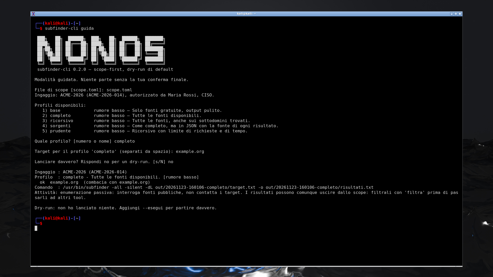
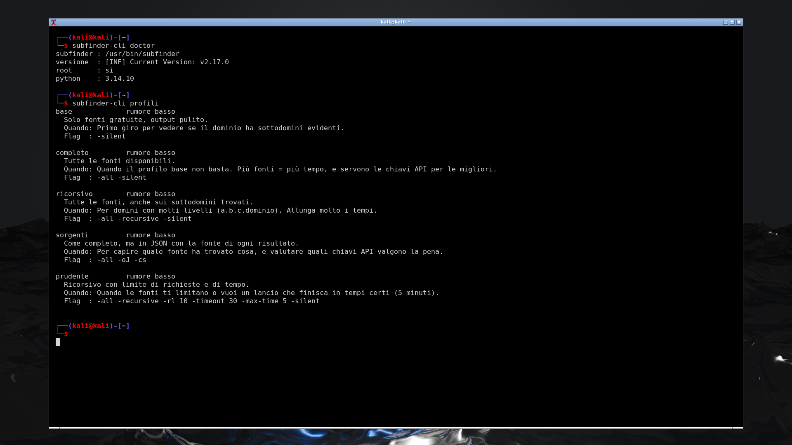
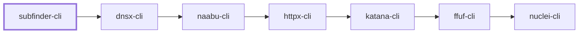

# subfinder-cli

🌐 **Italiano** · [English](README.en.md) · [中文](README.zh.md)

[](https://github.com/NON-OS/subfinder-cli/actions/workflows/ci.yml)


```
  ┌─ scope ─┐   ┌─ dry-run ─┐   ┌─ conferma ─┐   ┌─ subfinder ─┐   ┌─ audit ─┐   ┌─ rapporto ─┐
  │ valida  │ → │ mostra    │ → │ riferimento│ → │ parte   │ → │ catena  │ → │ riepilogo  │
  └─────────┘   └───────────┘   └────────────┘   └─────────┘   └─────────┘   └────────────┘
```

Enumerazione passiva di sottodomini con scope validato, dry-run di default e audit a catena di hash. Solo domini autorizzati.

> **Solo sistemi tuoi o con autorizzazione scritta.** Leggi [DISCLAIMER.md](DISCLAIMER.md) prima di lanciare qualsiasi cosa.

## Cos'è

`subfinder-cli` è un orchestratore sottile attorno a subfinder di ProjectDiscovery. Non sostituisce subfinder e non ne reimplementa le fonti. Fa tre cose: controlla che il dominio sia nello scope dichiarato, tiene un registro di cosa è stato lanciato, e filtra i risultati prima che finiscano in altri strumenti.

L'enumerazione passiva sembra innocua, e in gran parte lo è: non contatta il bersaglio. Il rischio sta dopo. Subfinder trova nomi che nessuno ti ha autorizzato a toccare (fornitori, servizi terzi, sottodomini ospitati da altri), e se quella lista va dritta in una scansione di porte, hai scansionato sistemi non tuoi. Il comando `filtra` esiste per questo: legge una lista da stdin e lascia passare solo ciò che lo scope nomina.

## In azione



*Modalità guidata (`subfinder-cli guida`) eseguita su Kali Linux: logo, scelta del profilo, validazione dello scope, anteprima del comando. Screenshot reale.*

```console
$ subfinder-cli lancia completo example.org --scope scope.toml
Ingaggio : ACME-2026 (ACME-2026-014)
Profilo  : completo - Tutte le fonti disponibili. [rumore basso]
  ok  example.org  (combacia con example.org)
Comando  : subfinder -all -silent -dL out/esempio/target.txt -o out/esempio/risultati.txt
Attività: enumerazione passiva: interroga fonti pubbliche, non contatta i target. I risultati possono comunque uscire dallo scope: filtrali con 'filtra' prima di passarli ad altri tool.

Dry-run: non ho lanciato niente. Aggiungi --esegui per partire davvero.
```

Con un target fuori scope, anche in mezzo a target validi, non parte niente:

```console
$ subfinder-cli lancia completo example.org altro.org --scope scope.toml
subfinder-cli: target fuori scope, non eseguo nulla:
  altro.org: hostname non presente tra gli inclusi
$ echo $?
3
```

Il comando `lancia` non parte mai senza `--esegui`. Quello che vedi sopra è un'anteprima.

L'output parla la lingua che scegli: `--lang it|en|zh` oppure la variabile `NONOS_LANG` (comoda per impostarla a livello di sistema). Si parte sempre in italiano. Il README è anche in [English](README.en.md) e [中文](README.zh.md).

## Cosa fa

| | |
|---|---|
| Scope | Dominio, host o URL (modalità `dominio`), con esclusioni e date di validità. Nel dubbio rifiuta. |
| Dry-run | Di default non parte niente. `--esegui` chiede conferma. |
| Profili | 5, con indicazione di rumore e di quando usarli. |
| Filtro flag | I flag che aggirano lo scope o rubano il controllo dell'output sono bloccati. |
| Filtro liste | `filtra` legge una lista da stdin e lascia passare solo ciò che è nello scope. |
| Scope firmato | Il cliente firma lo scope con la sua chiave SSH. Se il file cambia dopo la firma, non parte niente. |
| Audit | Registro a catena di hash. Hash dello scope e firmatario inclusi, valori sensibili oscurati. |
| Rapporto | Riepilogo dei risultati in testo, Markdown o JSON. |
| Confronto | Cosa è cambiato tra due lanci, con codice di uscita per la CI. |
| Dipendenze | Nessuna: solo la libreria standard di Python. |

## Piattaforma

Pensato per **Kali**, **Parrot** e Linux in generale: è lì che questi strumenti vivono e dove `subfinder-cli` viene usato. Gira anche su macOS. Windows non è provato, e lì alcuni controlli sui privilegi (`os.geteuid`) non valgono.

## Installazione

Serve Python 3.11 o più recente e subfinder nel `PATH`. Kali/Debian: sudo apt install subfinder. Ovunque con Go: go install -v github.com/projectdiscovery/subfinder/v2/cmd/subfinder@latest

```sh
git clone git@github.com:NON-OS/subfinder-cli.git
cd subfinder-cli
python3 -m venv .venv && . .venv/bin/activate
pip install -e .
subfinder-cli doctor
```

## Primo uso

### Il modo più semplice: modalità guidata

`subfinder-cli guida` ti fa le domande una alla volta — scope, profilo, target — mostra l'anteprima del comando e non lancia niente senza la tua conferma finale. È il modo consigliato per iniziare:

```sh
subfinder-cli guida
```

### Oppure a comandi

```sh
subfinder-cli init scope.toml          # crea il modello
$EDITOR scope.toml               # compilalo con il cliente
subfinder-cli verifica example.org --scope scope.toml
subfinder-cli lancia completo example.org --scope scope.toml            # dry-run
subfinder-cli lancia completo example.org --scope scope.toml --esegui   # parte davvero
```

In un terminale `--esegui` ti chiede di scrivere il riferimento dell'ingaggio. In uno script usa `--conferma`. Altri flag di subfinder si passano dopo `--`, se non sono tra i vietati ([docs/04-profili.md](docs/04-profili.md)).

Un flusso completo:

```sh
subfinder-cli lancia completo example.org --scope scope.toml --esegui
subfinder-cli rapporto out/*-completo/ --formato markdown > sottodomini.md
```

## Comandi

| Comando | Cosa fa |
|---|---|
| `guida` | modalità interattiva passo per passo: scope → profilo → target → conferma |
| `lancia <profilo> <target...>` | valida e costruisce (o lancia) subfinder. Con `-` legge i target da stdin |
| `filtra` | legge target da stdin e stampa solo quelli nello scope |
| `verifica <target...>` | dice se i target sono nello scope, senza lanciare |
| `scope-firma <file>` / `scope-verifica <file>` | firma e controlla lo scope con una chiave SSH |
| `rapporto <file_o_cartella>` | riepilogo dei risultati: elenco di sottodomini |
| `confronta <vecchio> <nuovo>` | differenze tra due lanci |
| `profili` | elenca i profili con i flag esatti |
| `audit [file]` | verifica la catena del registro |
| `init [file]` | crea un file di scope da compilare |
| `doctor` | controlla subfinder, versione, privilegi |

## Profili

| Profilo | Cosa fa | Rumore | Root |
|---|---|---|---|
| `base` | Solo fonti gratuite, output pulito. | basso | no |
| `completo` | Tutte le fonti disponibili. | basso | no |
| `ricorsivo` | Tutte le fonti, anche sui sottodomini trovati. | basso | no |
| `sorgenti` | Come completo, ma in JSON con la fonte di ogni risultato. | basso | no |
| `prudente` | Ricorsivo con limite di richieste e di tempo. | basso | no |



*`subfinder-cli doctor` (trova il binario reale di subfinder in `/usr/bin/`) e l'elenco dei profili, su Kali Linux.*

## Codici di uscita

| Codice | Significato |
|---|---|
| 0 | tutto a posto |
| 1 | `confronta --exit-code` ha trovato differenze |
| 2 | argomenti sbagliati o flag vietato |
| 3 | almeno un target fuori scope |
| 4 | scope illeggibile, malformato o scaduto |
| 5 | subfinder assente |
| 6 | esecuzione senza conferma, o profilo che richiede root senza sudo |
| 7 | subfinder è uscito con errore, o la catena di audit è spezzata |

## La catena di strumenti

Questo repository è uno di otto, pensati per lavorare insieme. Ognuno controlla lo scope per conto suo.



- [dnsx-cli](https://github.com/NON-OS/dnsx-cli): risoluzione dns
- [naabu-cli](https://github.com/NON-OS/naabu-cli): scansione di porte
- [httpx-cli](https://github.com/NON-OS/httpx-cli): sonde http
- [katana-cli](https://github.com/NON-OS/katana-cli): crawling web
- [ffuf-cli](https://github.com/NON-OS/ffuf-cli): fuzzing di percorsi
- [nuclei-cli](https://github.com/NON-OS/nuclei-cli): scansione di vulnerabilità
- [nmap-cli](https://github.com/NON-OS/nmap-cli): scansione di porte e servizi con nmap

## Documentazione

1. [Introduzione e filosofia](docs/01-introduzione.md)
2. [Autorizzazione: cosa serve prima di toccare un target](docs/02-autorizzazione.md)
3. [Il file di scope](docs/03-scope.md)
4. [Profili e flag vietati](docs/04-profili.md)
5. [Il registro di audit](docs/05-audit.md)
6. [Architettura](docs/06-architettura.md)
7. [Dove provarlo in sicurezza](docs/07-lab.md)
8. [Rapporti e confronti](docs/08-rapporti.md)
9. [Scope firmato](docs/09-firma.md)
10. [Compatibilità e prove](docs/10-compatibilita.md)

Il cheatsheet shell da cui è nato il progetto è in [scripts/](scripts/).

## Cosa non fa

Non scopre se hai il permesso: lo dichiari tu nel file di scope, e il programma ti crede. Non protegge da chi lancia `subfinder` direttamente. Il filtro sui flag è una rete di sicurezza contro gli errori, non una sandbox. I dettagli sono in [docs/06-architettura.md](docs/06-architettura.md).

## Sviluppo

```sh
make check     # ruff (lint + format), mypy --strict, test e coverage
```

Nessuna dipendenza a runtime (solo la libreria standard). Gli strumenti di sviluppo si installano con `pip install -e ".[dev]"`. Vedi [CONTRIBUTING.md](CONTRIBUTING.md) e [SECURITY.md](SECURITY.md).

## Licenza

MIT, vedi [LICENSE](LICENSE). La licenza copre il codice, non autorizza nessuna attività.
