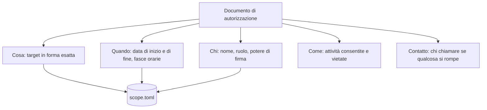

# Autorizzazione

🌐 **Italiano** · [English](en/02-autorizzazione.md) · [中文](zh/02-autorizzazione.md)

Un'attività senza permesso non diventa legittima perché è andata bene. Questa pagina spiega cosa serve prima, chi può darlo, e dove puoi allenarti senza chiedere niente a nessuno.

## Chi può autorizzare

Solo chi ha il controllo del sistema. Il tuo responsabile non basta se i server sono di un cliente. Il referente tecnico del cliente non basta se i server stanno da un cloud provider e il contratto del provider vieta i test. Spesso le autorizzazioni sono due: quella del proprietario dei dati e quella di chi ospita l'infrastruttura.

## Cosa deve dire il documento

Ogni campo del documento ha un posto nel file di scope. Se non riesci a compilare un campo, quel pezzo di autorizzazione manca.

Un punto che si trascura: "attività consentite". Per questo strumento: enumerazione passiva: interroga fonti pubbliche, non contatta i target. I risultati possono comunque uscire dallo scope: filtrali con 'filtra' prima di passarli ad altri tool. Se il cliente ha sistemi fragili, scrivilo nel documento e scegli un profilo prudente.

## Prima di lanciare

1. Ho il documento firmato e lo posso ritrovare tra sei mesi.
2. Il file di scope dice le stesse cose del documento, non una versione più comoda.
3. Le date sono ancora valide.
4. So chi chiamare se un servizio smette di rispondere.
5. Sto usando il profilo meno rumoroso che mi serve.

## Dove allenarsi senza chiedere

| Dove | Note |
|---|---|
| Il lab di questo repo | Container tuoi su una rete locale. Vedi [07-lab.md](07-lab.md). |
| Macchine virtuali tue | VirtualBox, UTM, qualsiasi hypervisor, rete host-only. |
| Un dominio tuo | Anche uno da pochi euro, per gli strumenti che lavorano su DNS e web pubblico. |
| Hack The Box, TryHackMe | Dentro le regole della piattaforma, solo sulle macchine assegnate. |
| Bug bounty | Solo i target dello scope del programma, e rispetta la lista delle attività vietate. |

## Cosa fare se sbagli

Succede. Un indirizzo incollato male, un dominio che si è rivelato essere di un altro.

1. Ferma il lancio (Ctrl-C).
2. Non cancellare niente: il registro di audit è la tua prova di buona fede e dice esattamente cosa è stato lanciato.
3. Avvisa subito il referente del cliente, o il proprietario del sistema se non è il cliente. Meglio una telefonata imbarazzante oggi che una denuncia dopo.
4. Scrivi cosa è successo mentre lo ricordi.

## Un'ultima cosa

Il file di scope è una dichiarazione tua, non una prova. Nessun programma può sapere se hai davvero il permesso. Se scrivi nello scope un target che non ti è stato assegnato, `subfinder-cli` lo analizzerà e nel registro ci sarà il tuo nome accanto.
