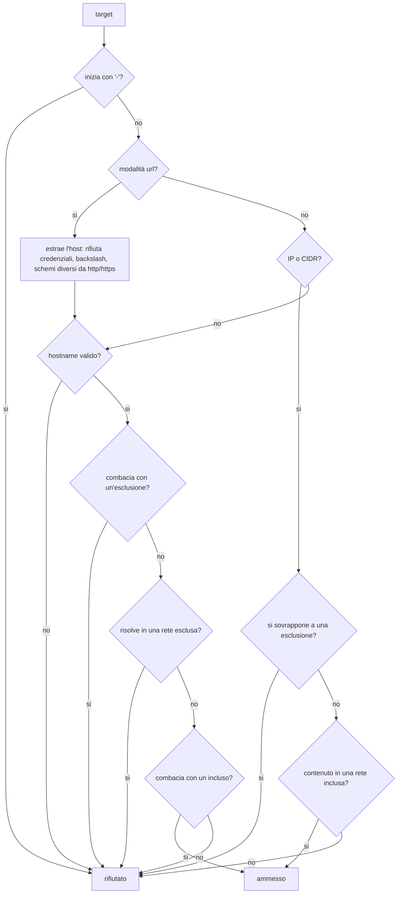

# Il file di scope

🌐 **Italiano** · [English](en/03-scope.md) · [中文](zh/03-scope.md)

Lo scope è un file TOML con due sezioni. `subfinder-cli init` ne crea uno da compilare.

```toml
[engagement]
nome = "ACME-2026"
autorizzato_da = "Maria Rossi, CISO, Acme S.p.A."
riferimento = "ACME-2026-014"
valido_dal = 2026-11-02
valido_fino = 2026-11-13

[scope]
include = [
    "example.org",
]
esclude = [
    "interno.example.org",
]
```

## I campi di `[engagement]`

Sono tutti obbligatori. Se ne manca uno il programma esce con codice 4.

| Campo | Cosa metterci |
|---|---|
| `nome` | un'etichetta breve per riconoscere l'ingaggio nei log |
| `autorizzato_da` | persona, ruolo e azienda di chi ha firmato |
| `riferimento` | numero del contratto o della lettera. È anche la frase che devi digitare per confermare un'esecuzione |
| `valido_dal`, `valido_fino` | date TOML, estremi inclusi |

Fuori da quelle date lo scope non vale e nessun comando parte, nemmeno il dry-run.

## Le voci di `include` ed `esclude`

| Forma | Esempio | Significato |
|---|---|---|
| IP singolo | `192.0.2.10` | quell'indirizzo |
| Rete CIDR | `192.0.2.0/25` | l'intera rete |
| Hostname | `app.example.org` | solo quel nome |
| Wildcard | `*.stage.example.org` | qualsiasi sottodominio, non il dominio stesso |

IPv4 e IPv6 funzionano allo stesso modo e non si confondono tra loro.

## Cosa si aspetta questo strumento

Modalità `dominio`. Il dominio va scritto per intero. Un wildcard come *.example.org non copre example.org stesso.

I target che passi a `lancia` possono essere:

- in modalità `dominio`: solo nomi di dominio, senza schema né percorso;
- in modalità `host`: indirizzi IP, reti CIDR esatte o hostname;
- in modalità `url`: URL completi (`https://host:8443/percorso`), `host:porta` o `host`. Viene confrontato l'host, mai il percorso.

## Come viene deciso



L'esclusione vince sempre. Se includi `192.0.2.0/25` ed escludi `192.0.2.1`, il target `192.0.2.0/25` viene rifiutato per intero, perché contiene l'indirizzo escluso. Usa i singoli host oppure spezza la rete in blocchi che lo evitano.

## Cose che il programma rifiuta apposta

**Un CIDR con i bit d'host accesi**, tipo `192.0.2.5/25`. È ambiguo: scrivi `192.0.2.5` oppure `192.0.2.0/25`.

**`0.0.0.0/0` nelle inclusioni**, cioè tutto internet. Uno scope che autorizza tutto non è uno scope.

**Wildcard su un dominio di primo livello**, tipo `*.org`.

**Target che iniziano con `-`**. Sono flag travestiti.

**URL con credenziali o backslash**, tipo `http://192.0.2.5@evil.example/`. Sembrano puntare a un indirizzo interno e invece l'host vero è un altro. Sono un trucco classico per confondere i filtri.

**Schemi diversi da http e https** (`ftp://`, `file://`, `javascript:`).

## Gli hostname e il DNS

Un hostname viene ammesso solo se è scritto nello scope. Non viene risolto per capire se "per caso" cade in una rete inclusa, perché il DNS può cambiare sotto i tuoi piedi.

Se però lo scope ha delle esclusioni di rete, ogni hostname viene risolto e rifiutato se il risultato cade in una di quelle. Un limite onesto: tra la risoluzione fatta qui e quella fatta da subfinder qualche istante dopo, il DNS può rispondere in modo diverso. Per i test dove conta, usa gli indirizzi IP.

## Le porte

Lo scope non controlla le porte. Se `app.example.org` è in scope, lo è su qualsiasi porta. Se il cliente ha autorizzato solo alcune porte, scrivilo nel documento di autorizzazione e usa un profilo che le limiti.

## Dove tenere il file

Fuori dal repository. Il `.gitignore` di questo progetto esclude `scope.toml`, ma non fidarti: i nomi dei clienti e le loro reti non vanno su un repository, nemmeno privato. Il registro di audit contiene l'hash del file di scope, così se lo modifichi dopo un lancio si vede.
