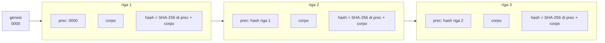

# Il registro di audit

🌐 **Italiano** · [English](en/05-audit.md) · [中文](zh/05-audit.md)

Ogni volta che lanci `subfinder-cli lancia` viene aggiunta una riga a `subfinder-cli.audit.jsonl` (o al file che indichi con `--audit`). Serve a rispondere, a distanza di mesi, a tre domande: cosa è stato lanciato, da chi, sotto quale autorizzazione.

## Cosa viene scritto

| Evento | Quando |
|---|---|
| `dry_run` | hai lanciato senza `--esegui` |
| `rifiutato` | hai chiesto `--esegui` ma la conferma è mancata |
| `avviata` | prima di far partire subfinder |
| `conclusa` | quando subfinder esce, con il suo codice |

Un target fuori scope non produce nessuna riga: il programma esce prima, e non è partito niente da registrare.

Ogni riga contiene la data in UTC, il nome dell'ingaggio, il riferimento, l'utente di sistema, il profilo, i target, il comando completo e lo SHA-256 del file di scope usato in quel momento. Quest'ultimo serve a dimostrare che lo scope non è stato ritoccato dopo.

## Valori sensibili

I flag che possono contenere segreti (header di autenticazione, token) vengono registrati con il valore oscurato: `-H [oscurato]`. Il comando che vedi a terminale resta completo, perché l'hai scritto tu, ma il registro viene spesso condiviso. Non è una garanzia: se metti un token in un'altra posizione (per esempio dentro un URL), finisce nel registro.

## La catena

Ogni riga include l'hash della riga precedente. Se cambi una riga a metà, il suo hash non torna più, e tutte quelle dopo puntano a un hash che non esiste.



Per controllare:

```sh
subfinder-cli audit
subfinder-cli audit /percorso/altro.audit.jsonl
```

Se la catena è integra stampa il numero di righe ed esce con 0. Se no, dice a quale riga si spezza ed esce con 7.

## Cosa protegge e cosa no

Rileva la modifica o la cancellazione di una riga in mezzo, e l'inserimento di una riga falsa in mezzo.

Non rileva due cose. La prima: chi ha accesso in scrittura al file può ricostruire la catena da zero, ricalcolando tutti gli hash, e il risultato passa la verifica. La seconda: chi toglie le ultime righe lascia una catena valida, solo più corta.

Per coprire questi casi serve qualcosa fuori dal file. Due strade semplici: copiare l'ultimo hash in un posto che non controlli solo tu (una mail al cliente, un ticket), oppure spedire il registro a un server di log remoto in sola aggiunta. `subfinder-cli` non lo fa al posto tuo perché dipende dall'infrastruttura che hai.

## Riservatezza

Il registro contiene indirizzi e nomi dei clienti. Trattalo come un dato del cliente: non va su repository pubblici, né su chat. Il `.gitignore` lo esclude, ma controlla prima di ogni commit.
