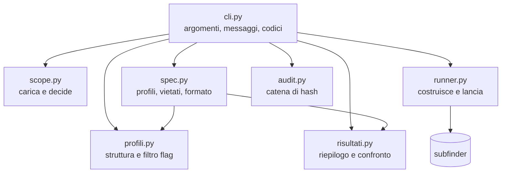
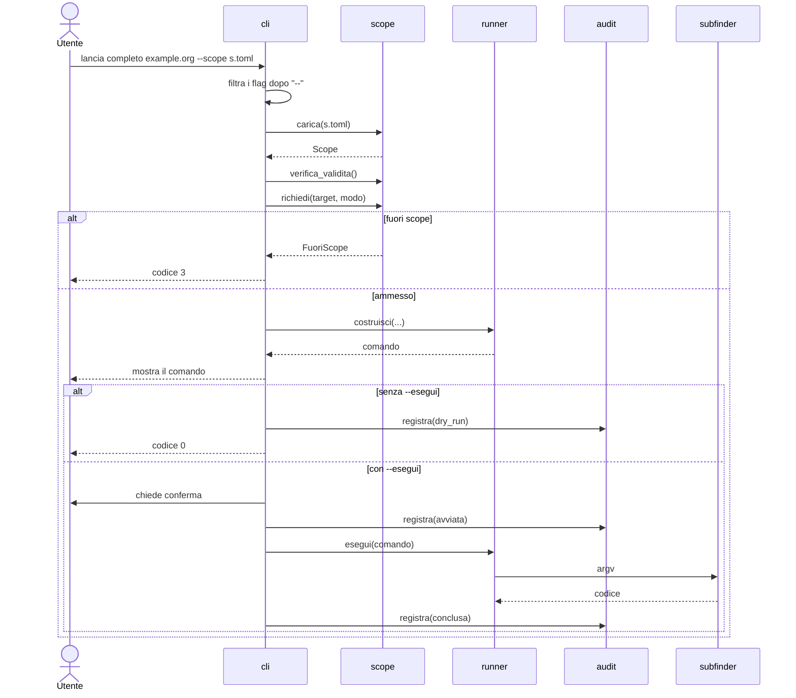

# Architettura

🌐 **Italiano** · [English](en/06-architettura.md) · [中文](zh/06-architettura.md)

Poco codice, ciascun pezzo con un compito solo. Si legge tutto in un pomeriggio.

## I moduli



`scope.py`, `audit.py` e `profili.py` non sanno niente del tool e non lanciano processi. Tutto ciò che è specifico di subfinder (profili, flag vietati, come si leggono i risultati) sta in `spec.py`. Solo `runner.py` tocca `subprocess`. Questo rende i test veloci e senza rete: nessun test ha bisogno di subfinder installato, e quelli di integrazione usano un finto eseguibile.

## Il percorso di un comando



## Scelte che meritano una spiegazione

**Mai una shell.** Il comando è una lista di argomenti passata a `subprocess.run`. Un target come `x; rm -rf ~` non può fare niente: verrebbe prima rifiutato dallo scope, e anche se arrivasse al tool sarebbe un nome strano e basta. I target vengono passati tramite un file, non come argomenti, quando il tool lo permette.

**Validare tutto o niente.** Se dieci target sono ammessi e uno no, non parte nulla. Un lancio parziale è peggio di nessun lancio: ti fa credere di aver coperto un perimetro che non hai coperto.

**Il filtro sui flag è per nome.** I flag dei tool Go (`-flag valore` e `-flag=valore`, con uno o due trattini) vengono normalizzati prima del confronto, senza distinguere maiuscole e minuscole. Nel dubbio si vieta.

**L'audit viene scritto prima dell'avvio.** Se il processo muore a metà o viene interrotto con un segnale, la riga `avviata` esiste e `conclusa` no: è un'informazione utile. Scrivere solo a lancio finito farebbe sparire i lanci interrotti.

**Il dry-run funziona anche senza subfinder installato.** Mostra un'anteprima e una nota. Solo `--esegui` richiede il binario.

**Python 3.11 come minimo.** Serve `tomllib` nella libreria standard, per non dipendere da un parser TOML esterno.

## Limiti

Quello che ti serve sapere prima di fidarti.

1. Il file di scope è una dichiarazione dell'utente. Se è sbagliato, il controllo è inutile.
2. Chi lancia `subfinder` direttamente non passa da qui.
3. Il filtro sui flag non è una sandbox.
4. Tra la risoluzione DNS fatta da `scope.py` e quella fatta da subfinder passa del tempo.
5. L'audit rileva manomissioni parziali, non una riscrittura completa. Vedi [05-audit.md](05-audit.md).
6. Su sistemi dove `os.geteuid` non esiste (Windows) i controlli sui privilegi non funzionano. Il progetto è provato solo su macOS e Linux.
7. Non conosco ogni flag di ogni versione di subfinder: se una versione nuova ne introduce uno che aggira lo scope, il filtro non lo conosce. Segnalalo.

## Eseguire i test

```sh
make check
```
