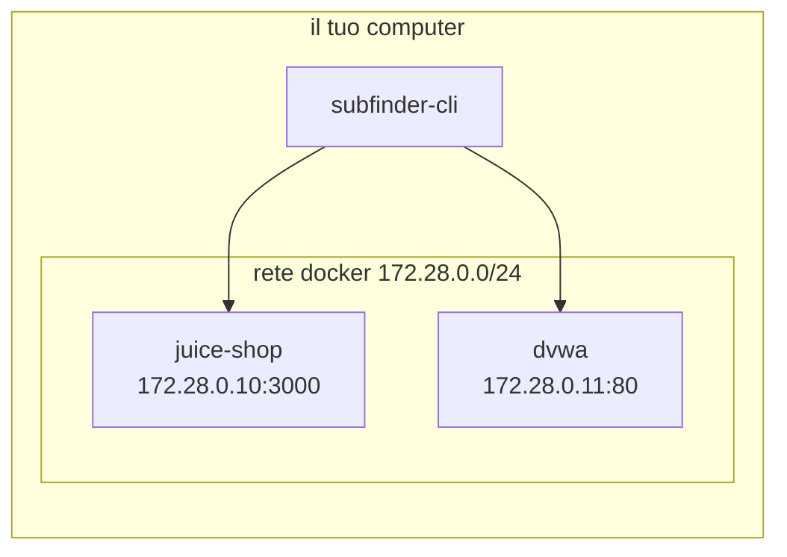

# Dove provarlo in sicurezza

🌐 **Italiano** · [English](en/07-lab.md) · [中文](zh/07-lab.md)

Per imparare serve qualcosa da analizzare che sia tuo.

Subfinder lavora su domini reali e fonti pubbliche, quindi un lab locale non ha senso. Per provarlo in modo sano usa un dominio tuo, anche uno da pochi euro, con qualche sottodominio configurato e un certificato (Let's Encrypt va benissimo, finisce in certificate transparency). Metti quel dominio in `include` e prova `subfinder-cli lancia base tuo-dominio.tld`.

## Il lab Docker

In `lab/` c'è un `docker-compose.yml` che avvia due bersagli volutamente vulnerabili su una rete isolata.



Le due applicazioni sono OWASP Juice Shop e DVWA, progetti pubblici fatti apposta per essere attaccati. Non esporle mai su una rete vera.

```sh
cd lab && docker compose up -d
```

Lo scope per il lab è in `examples/scope.lab.toml`. Le date vanno aggiornate: quelle d'esempio scadono.

## Esercizi

1. Lancia lo stesso profilo con un target in scope e uno fuori. Quale codice ottieni, e perché non parte nemmeno il primo?
2. Aggiungi un host a `esclude` e rilancia. Cosa cambia?
3. Cambia `valido_fino` con una data passata.
4. Apri `subfinder-cli.audit.jsonl`, cambia a mano una lettera in una riga a metà e lancia `subfinder-cli audit`.
5. Prova a passare un flag vietato dopo `--` e leggi il messaggio.
6. Fai due lanci e confrontali con `subfinder-cli confronta`.

## Pulizia

```sh
docker compose down
```

## Nota

Il compose file non è stato provato su ogni versione di Docker. Se il comando fallisce, controlla che le immagini esistano ancora sul registro e che la rete `172.28.0.0/24` non confligga con una già in uso.
