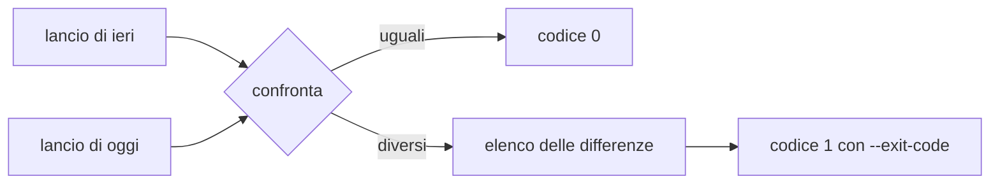

# Rapporti e confronti

🌐 **Italiano** · [English](en/08-rapporti.md) · [中文](zh/08-rapporti.md)

Ogni lancio con `--esegui` lascia in `out/<data>-<profilo>/` i risultati (`risultati.*`) e la lista dei target usata (`target.txt`).

## Riepilogo

```sh
subfinder-cli rapporto out/20260101-120000-completo/
subfinder-cli rapporto out/20260101-120000-completo/ --formato markdown > rapporto.md
subfinder-cli rapporto out/20260101-120000-completo/ --formato json | jq .
```

Accetta una cartella (legge tutti i file `risultati*`) o un singolo file. Il formato `testo` è per il terminale, il `markdown` è pronto da incollare in un rapporto, il `json` serve a chi elabora i dati con altri strumenti.

Il riepilogo raggruppa per **Fonte**. I doppioni vengono eliminati.

## Cosa è cambiato dall'ultima volta

```sh
subfinder-cli confronta vecchio/ nuovo/
```

```
+ risultato comparso
- risultato sparito
```

Con `--exit-code` il comando esce con 1 se ci sono differenze, così una pipeline può accorgersi di una novità.



## Limiti

Due lanci con profili diversi non sono confrontabili in modo sensato: il secondo troverà sempre qualcosa di "nuovo". Il confronto guarda l'identità del risultato (per esempio l'URL o la coppia host e porta), non i dettagli: un titolo che cambia non conta come differenza.
