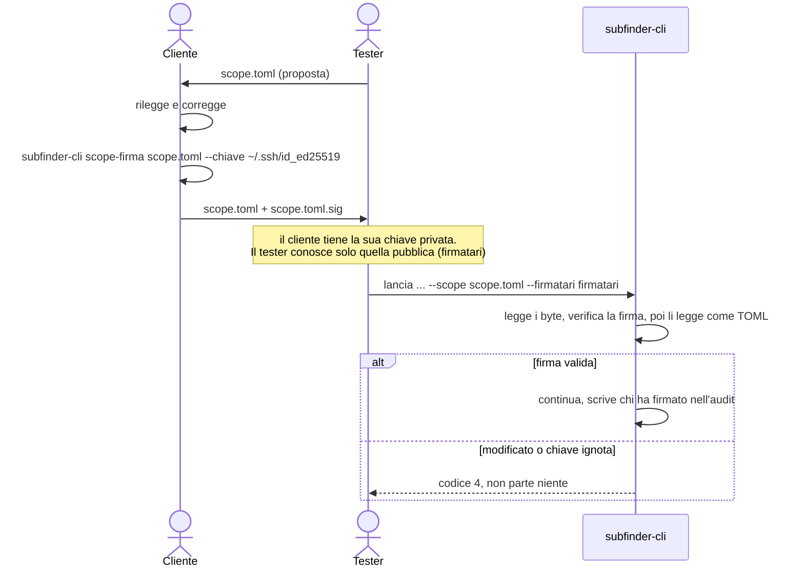

# Scope firmato

🌐 **Italiano** · [English](en/09-firma.md) · [中文](zh/09-firma.md)

Lo scope è una dichiarazione. Con la firma diventa una prova: chi ha l'autorità di autorizzare lo firma con la sua chiave SSH, e `subfinder-cli` si rifiuta di partire se il file è stato modificato dopo la firma o se a firmarlo è stata una chiave che non conosce.

Serve solo `ssh-keygen`, che c'è su macOS e su qualunque Linux con OpenSSH. Nessuna dipendenza in più.

## Chi fa cosa



La verifica avviene sugli stessi byte che poi vengono letti come scope: non c'è un momento tra il controllo e l'uso in cui il file possa cambiare.

## Il file dei firmatari

È il formato `allowed_signers` di OpenSSH, una riga per chiave:

```
maria.rossi@acme.example namespaces="subfinder-cli" ssh-ed25519 AAAAC3NzaC1lZDI1NTE5AAAA...
```

Il campo `namespaces` lega la chiave a questo programma: una firma fatta per `git` o per altro non viene accettata, anche se la chiave è la stessa.

## Passi

Il cliente (o chi ha l'autorità) firma:

```sh
subfinder-cli scope-firma scope.toml --chiave ~/.ssh/id_ed25519
```

Crea `scope.toml.sig`. Se la chiave ha una passphrase la chiede `ssh-keygen`. Se esiste già una firma, il comando non la sovrascrive: cancellala a mano per rifirmare.

Il tester controlla:

```sh
subfinder-cli scope-verifica scope.toml --firmatari firmatari
# ok: firma valida di maria.rossi@acme.example (SHA256:...)
```

E poi lancia con la firma obbligatoria:

```sh
subfinder-cli lancia completo example.org --scope scope.toml --firmatari firmatari
```

Senza `--firmatari` la firma non viene richiesta. Chi vuole che sia sempre obbligatoria può metterlo in un alias.

## Cosa finisce nell'audit

Ogni riga del registro, oltre all'hash del file di scope, porta `scope_firmato_da` e `scope_firma_fp` (l'impronta della chiave). Così, a distanza di mesi, si può dire non solo quale scope era in uso ma chi lo aveva firmato.

## Cosa non fa

Non sa se la persona che ha firmato avesse davvero il potere di autorizzare quei sistemi: quello lo stabilisce il contratto, non la crittografia. Non protegge una chiave privata rubata. Non impedisce di lanciare lo strumento senza `--firmatari`, né di lanciare il tool sotto direttamente.

Una firma non ha scadenza propria: la validità nel tempo è quella dichiarata nel file (`valido_dal`, `valido_fino`), che essendo firmata non si può allungare di nascosto.
