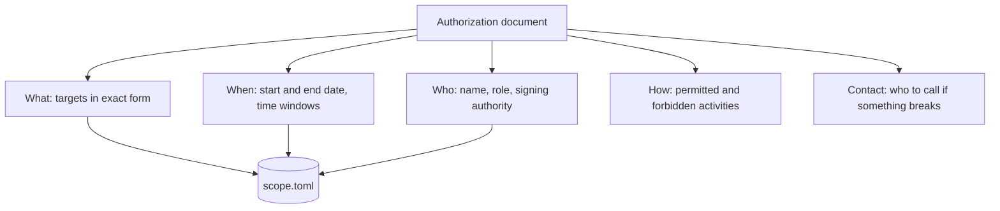

# Authorization

🌐 [Italiano](../02-autorizzazione.md) · **English** · [中文](../zh/02-autorizzazione.md)

An activity without permission does not become legitimate because it went well. This page covers what you need beforehand, who can give it, and where you can practice without asking anyone.

## Who can authorize

Only whoever controls the system. Your manager is not enough if the servers belong to a client. The client's technical contact is not enough if the servers sit with a cloud provider whose contract forbids testing. Often there are two authorizations: one from the data owner and one from whoever hosts the infrastructure.

## What the document must say

Every field in the document has a place in the scope file. If you cannot fill in a field, that piece of the authorization is missing.

One point that gets overlooked: "permitted activities". For this tool: passive enumeration: it queries public sources and does not contact the targets. The results can still fall outside the scope: filter them with 'filtra' before passing them to other tools. If the client has fragile systems, put that in the document and pick a conservative profile.

## Before you run

1. I have the signed document and can find it again in six months.
2. The scope file says the same things as the document, not a more convenient version.
3. The dates are still valid.
4. I know who to call if a service stops responding.
5. I am using the least noisy profile that does the job.

## Where to practice without asking

| Where | Notes |
|---|---|
| The lab in this repo | Your own containers on a local network. See [07-lab.md](07-lab.md). |
| Your own virtual machines | VirtualBox, UTM, any hypervisor, host-only network. |
| A domain you own | Even a cheap one, for tools that work on DNS and the public web. |
| Hack The Box, TryHackMe | Within the platform rules, only on the machines assigned to you. |
| Bug bounty | Only targets in the program scope, and respect the list of forbidden activities. |

## What to do if you get it wrong

It happens. A badly pasted address, a domain that turned out to belong to someone else.

1. Stop the run (Ctrl-C).
2. Do not delete anything: the audit log is your proof of good faith and states exactly what was run.
3. Notify the client contact immediately, or the system owner if that is not the client. Better an embarrassing phone call today than a criminal complaint later.
4. Write down what happened while you still remember it.

## One last thing

The scope file is your own statement, not proof. No program can know whether you actually have permission. If you put a target in the scope that was not assigned to you, `subfinder-cli` will scan it and the log will have your name next to it.
