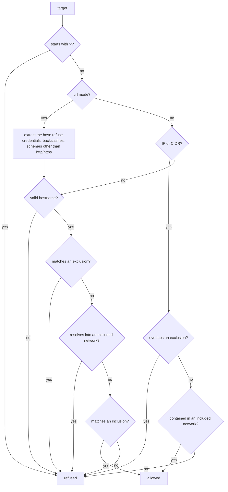

# The scope file

🌐 [Italiano](../03-scope.md) · **English** · [中文](../zh/03-scope.md)

The scope is a TOML file with two sections. `subfinder-cli init` creates one for you to fill in.

```toml
[engagement]
nome = "ACME-2026"
autorizzato_da = "Maria Rossi, CISO, Acme S.p.A."
riferimento = "ACME-2026-014"
valido_dal = 2026-11-02
valido_fino = 2026-11-13

[scope]
include = [
    "example.org",
]
esclude = [
    "interno.example.org",
]
```

## The `[engagement]` fields

All are required. If one is missing the program exits with code 4.

| Field | What goes in it |
|---|---|
| `nome` | a short label to recognize the engagement in the logs |
| `autorizzato_da` | person, role and company of whoever signed |
| `riferimento` | contract or letter number. It is also the phrase you must type to confirm an execution |
| `valido_dal`, `valido_fino` | TOML dates, both ends inclusive |

Outside those dates the scope is not valid and no command runs, not even a dry-run.

## Entries in `include` and `esclude`

| Form | Example | Meaning |
|---|---|---|
| Single IP | `192.0.2.10` | that address |
| CIDR network | `192.0.2.0/25` | the whole network |
| Hostname | `app.example.org` | only that name |
| Wildcard | `*.stage.example.org` | any subdomain, not the domain itself |

IPv4 and IPv6 work the same way and are never mixed up.

## What this tool expects

`dominio` mode. Write the domain in full. A wildcard such as *.example.org does not cover example.org itself.

The targets you pass to `lancia` can be:

- in `dominio` mode: domain names only, no scheme or path;
- in `host` mode: IP addresses, exact CIDR networks or hostnames;
- in `url` mode: full URLs (`https://host:8443/percorso`), `host:porta` or `host`. The host is checked, never the path.

## How the decision is made



Exclusion always wins. If you include `192.0.2.0/25` and exclude `192.0.2.1`, the target `192.0.2.0/25` is refused in full, because it contains the excluded address. Use single hosts or split the network into blocks that avoid it.

## Things the program refuses on purpose

**A CIDR with host bits set**, such as `192.0.2.5/25`. It is ambiguous: write `192.0.2.5` or `192.0.2.0/25`.

**`0.0.0.0/0` in the inclusions**, i.e. the whole internet. A scope that authorizes everything is not a scope.

**Wildcards on a top-level domain**, such as `*.org`.

**Targets starting with `-`**. They are flags in disguise.

**URLs with credentials or backslashes**, such as `http://192.0.2.5@evil.example/`. They look like they point to an internal address but the real host is something else. It is a classic trick to confuse filters.

**Schemes other than http and https** (`ftp://`, `file://`, `javascript:`).

## Hostnames and DNS

A hostname is allowed only if it is written in the scope. It is not resolved to see whether it "happens" to fall in an included network, because DNS can change under your feet.

If the scope has network exclusions, though, every hostname is resolved and refused if the result falls in one of them. An honest limitation: between the resolution done here and the one subfinder does a moment later, DNS may answer differently. For tests where it matters, use IP addresses.

## Ports

The scope does not check ports. If `app.example.org` is in scope, it is in scope on any port. If the client authorized only some ports, write that in the authorization document and use a profile that restricts them.

## Where to keep the file

Outside the repository. This project's `.gitignore` excludes `scope.toml`, but do not rely on it: client names and their networks do not belong in a repository, not even a private one. The audit log contains the hash of the scope file, so if you modify it after a run, it shows.
