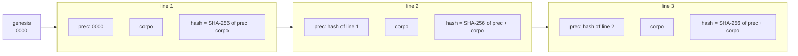

# The audit log

🌐 [Italiano](../05-audit.md) · **English** · [中文](../zh/05-audit.md)

Every time you run `subfinder-cli lancia` a line is appended to `subfinder-cli.audit.jsonl` (or to the file you pass with `--audit`). Its job is to answer three questions months later: what was run, by whom, under which authorization.

## What gets written

| Event | When |
|---|---|
| `dry_run` | you ran without `--esegui` |
| `rifiutato` | you asked for `--esegui` but the confirmation was missing |
| `avviata` | before subfinder starts |
| `conclusa` | when subfinder exits, with its exit code |

An out-of-scope target produces no line: the program exits earlier, and nothing started that needs logging.

Each line contains the UTC date, the engagement name, the reference, the system user, the profile, the targets, the full command, and the SHA-256 of the scope file in use at that moment. The last one is there to prove the scope was not touched up afterwards.

## Sensitive values

Flags that can carry secrets (authentication headers, tokens) are logged with the value redacted: `-H [oscurato]`. The command you see in the terminal stays complete, because you wrote it, but the log often gets shared. This is not a guarantee: if you put a token somewhere else (inside a URL, for instance), it ends up in the log.

## The chain

Each line includes the hash of the previous line. If you change a line in the middle, its hash no longer matches, and every line after it points to a hash that does not exist.



To check:

```sh
subfinder-cli audit
subfinder-cli audit /percorso/altro.audit.jsonl
```

If the chain is intact it prints the number of lines and exits with 0. If not, it says at which line it breaks and exits with 7.

## What it protects and what it does not

It detects modification or deletion of a line in the middle, and insertion of a fake line in the middle.

It does not detect two things. First: anyone with write access to the file can rebuild the chain from scratch, recomputing every hash, and the result passes verification. Second: anyone who removes the last lines leaves a valid chain, just a shorter one.

Covering these cases takes something outside the file. Two simple options: copy the last hash somewhere you are not the only one in control of (an email to the client, a ticket), or ship the log to an append-only remote log server. `subfinder-cli` does not do it for you because it depends on the infrastructure you have.

## Confidentiality

The log contains client addresses and names. Treat it as client data: it does not go in public repositories or in chats. The `.gitignore` excludes it, but check before every commit.
