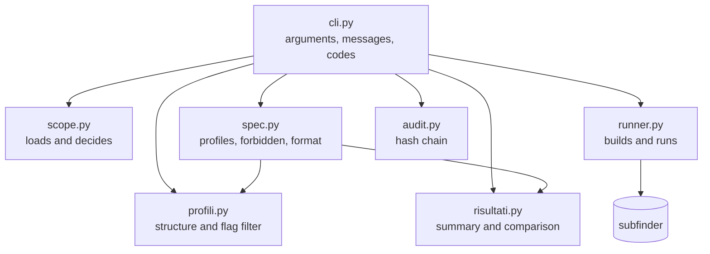

# Architecture

🌐 [Italiano](../06-architettura.md) · **English** · [中文](../zh/06-architettura.md)

Little code, each piece with a single job. You can read all of it in an afternoon.

## The modules



`scope.py`, `audit.py` and `profili.py` know nothing about the tool and do not start processes. Everything specific to subfinder (profiles, forbidden flags, how results are read) lives in `spec.py`. Only `runner.py` touches `subprocess`. This keeps tests fast and offline: no test needs subfinder installed, and the integration tests use a fake executable.

## The path of a command

```mermaid
sequenceDiagram
    actor U as User
    participant C as cli
    participant S as scope
    participant R as runner
    participant A as audit
    participant N as subfinder
    U->>C: lancia completo example.org --scope s.toml
    C->>C: filters the flags after "--"
    C->>S: carica(s.toml)
    S-->>C: Scope
    C->>S: verifica_validita()
    C->>S: richiedi(target, modo)
    alt out of scope
        S-->>C: FuoriScope
        C-->>U: code 3
    else allowed
        C->>R: costruisci(...)
        R-->>C: command
        C-->>U: shows the command
        alt without --esegui
            C->>A: registra(dry_run)
            C-->>U: code 0
        else with --esegui
            C->>U: asks for confirmation
            C->>A: registra(avviata)
            C->>R: esegui(comando)
            R->>N: argv
            N-->>R: code
            C->>A: registra(conclusa)
        end
    end
```



## Choices that need an explanation

**Never a shell.** The command is a list of arguments passed to `subprocess.run`. A target like `x; rm -rf ~` cannot do anything: it would be refused by the scope first, and even if it reached the tool it would just be an odd name. Targets are passed through a file, not as arguments, when the tool allows it.

**Validate all or nothing.** If ten targets are allowed and one is not, nothing runs. A partial run is worse than no run: it makes you believe you covered a perimeter you did not.

**The flag filter works by name.** Go tool flags (`-flag valore` and `-flag=valore`, with one or two dashes) are normalized before comparison, case-insensitively. When in doubt, forbid.

**The audit entry is written before start.** If the process dies halfway or is interrupted by a signal, the `avviata` line exists and `conclusa` does not: that is useful information. Writing only after the run finishes would make interrupted runs disappear.

**Dry-run works even without subfinder installed.** It shows a preview and a note. Only `--esegui` needs the binary.

**Python 3.11 at minimum.** It needs `tomllib` in the standard library, so as not to depend on an external TOML parser.

## Limitations

What you need to know before trusting it.

1. The scope file is a statement by the user. If it is wrong, the check is useless.
2. Anyone who runs `subfinder` directly does not go through here.
3. The flag filter is not a sandbox.
4. Time passes between the DNS resolution done by `scope.py` and the one done by subfinder.
5. The audit detects partial tampering, not a full rewrite. See [05-audit.md](05-audit.md).
6. On systems where `os.geteuid` does not exist (Windows) the privilege checks do not work. The project is tested only on macOS and Linux.
7. I do not know every flag of every version of subfinder: if a new version introduces one that bypasses the scope, the filter does not know about it. Report it.

## Running the tests

```sh
make check
```
