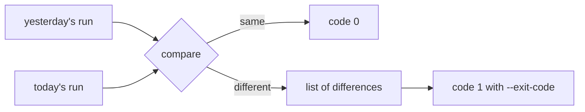

# Reports and comparisons

🌐 [Italiano](../08-rapporti.md) · **English** · [中文](../zh/08-rapporti.md)

Every run with `--esegui` leaves the results (`risultati.*`) and the target list used (`target.txt`) in `out/<data>-<profilo>/`.

## Summary

```sh
subfinder-cli rapporto out/20260101-120000-completo/
subfinder-cli rapporto out/20260101-120000-completo/ --formato markdown > rapporto.md
subfinder-cli rapporto out/20260101-120000-completo/ --formato json | jq .
```

It accepts a directory (reads all `risultati*` files) or a single file. The `testo` format is for the terminal, `markdown` is ready to paste into a report, `json` is for whoever processes the data with other tools.

The summary groups by **Source**. Duplicates are removed.

## What changed since last time

```sh
subfinder-cli confronta vecchio/ nuovo/
```

```
+ new result
- result gone
```

With `--exit-code` the command exits with 1 if there are differences, so a pipeline can notice something new.



## Limitations

Two runs with different profiles cannot be meaningfully compared: the second will always find something "new". The comparison looks at the identity of the result (for example the URL or the host and port pair), not the details: a changed title does not count as a difference.
