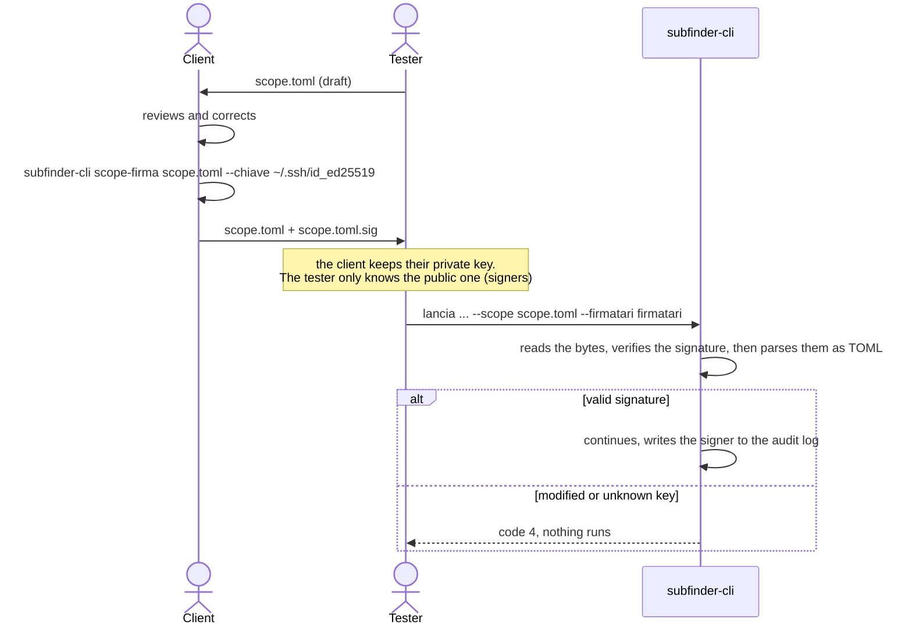

# Signed scope

🌐 [Italiano](../09-firma.md) · **English** · [中文](../zh/09-firma.md)

The scope is a statement. With a signature it becomes evidence: whoever has the authority to authorize signs it with their SSH key, and `subfinder-cli` refuses to start if the file was modified after signing or if it was signed by a key it does not know.

All it needs is `ssh-keygen`, which ships with macOS and any Linux with OpenSSH. No extra dependencies.

## Who does what



Verification is done on the same bytes that are then read as the scope: there is no window between check and use in which the file can change.

## The signers file

It is the OpenSSH `allowed_signers` format, one line per key:

```
maria.rossi@acme.example namespaces="subfinder-cli" ssh-ed25519 AAAAC3NzaC1lZDI1NTE5AAAA...
```

The `namespaces` field binds the key to this program: a signature made for `git` or anything else is not accepted, even if the key is the same.

## Steps

The client (or whoever has the authority) signs:

```sh
subfinder-cli scope-firma scope.toml --chiave ~/.ssh/id_ed25519
```

This creates `scope.toml.sig`. If the key has a passphrase, `ssh-keygen` asks for it. If a signature already exists, the command does not overwrite it: delete it by hand to re-sign.

The tester checks:

```sh
subfinder-cli scope-verifica scope.toml --firmatari firmatari
# ok: valid signature by maria.rossi@acme.example (SHA256:...)
```

And then runs with the signature required:

```sh
subfinder-cli lancia completo example.org --scope scope.toml --firmatari firmatari
```

Without `--firmatari` the signature is not required. If you want it always required, put it in an alias.

## What goes into the audit log

Every log line, besides the hash of the scope file, carries `scope_firmato_da` and `scope_firma_fp` (the key fingerprint). So months later you can say not only which scope was in use but who signed it.

## What it does not do

It does not know whether the person who signed actually had the power to authorize those systems: the contract settles that, not cryptography. It does not protect a stolen private key. It does not prevent running the tool without `--firmatari`, nor running the underlying tool directly.

A signature has no expiry of its own: validity over time is what the file declares (`valido_dal`, `valido_fino`), and since that is signed it cannot be quietly extended.
