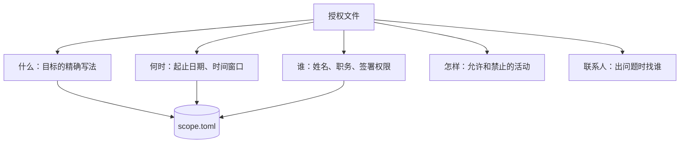

# 授权

🌐 [Italiano](../02-autorizzazione.md) · [English](../en/02-autorizzazione.md) · **中文**

> ⚠️ 本页为机器翻译草稿，正式发布前需母语者校对。

未经许可的活动，不会因为结果顺利就变得合法。本页说明事先需要什么、谁有权授予，以及在哪里可以不经任何人许可地练习。

## 谁可以授权

只有对系统拥有控制权的人。如果服务器属于客户，你的上级说了不算。如果服务器托管在云服务商，而服务商合同禁止测试，客户的技术对接人说了也不算。授权往往需要两份：一份来自数据所有者，一份来自基础设施托管方。

## 授权文件应写明什么

文件中的每一项在作用域文件里都有对应位置。如果某一项填不出来，说明这部分授权缺失。

一个常被忽略的点是"允许的活动"。就本工具而言：被动枚举：查询公开数据源，不接触目标。结果仍可能落在作用域之外：在传给其他工具之前，先用 'filtra' 过滤。 如果客户的系统比较脆弱，请在文件中写明，并选择一个保守的配置。

## 运行之前

1. 我有签署好的文件，六个月后也能找得到。
2. 作用域文件与授权文件内容一致，而不是一个更方便的版本。
3. 日期仍在有效期内。
4. 我知道某个服务停止响应时该找谁。
5. 我使用的是满足需要的噪声最小的配置。

## 无需许可的练习场所

| 场所 | 说明 |
|---|---|
| 本仓库的 lab | 你自己的容器，运行在本地网络上。见 [07-lab.md](07-lab.md)。 |
| 你自己的虚拟机 | VirtualBox、UTM 或任何 hypervisor，使用 host-only 网络。 |
| 你自己的域名 | 几欧元的也行，适用于面向 DNS 和公网 Web 的工具。 |
| Hack The Box、TryHackMe | 遵守平台规则，仅限分配给你的机器。 |
| Bug bounty | 仅限项目作用域内的目标，并遵守禁止活动清单。 |

## 出错了怎么办

这种事会发生。地址贴错了，某个域名后来发现属于别人。

1. 停止运行（Ctrl-C）。
2. 什么都不要删：审计日志是你善意的证明，准确记录了运行过的内容。
3. 立即通知客户的对接人；如果系统所有者不是客户，则通知所有者。今天打一个尴尬的电话，好过日后被起诉。
4. 趁还记得，把经过写下来。

## 最后一点

作用域文件是你自己的声明，不是证据。没有任何程序能知道你是否真的获得了许可。如果你在作用域里写入了一个未分配给你的目标，`subfinder-cli` 会照样对它进行分析，而日志里会记着你的名字。
