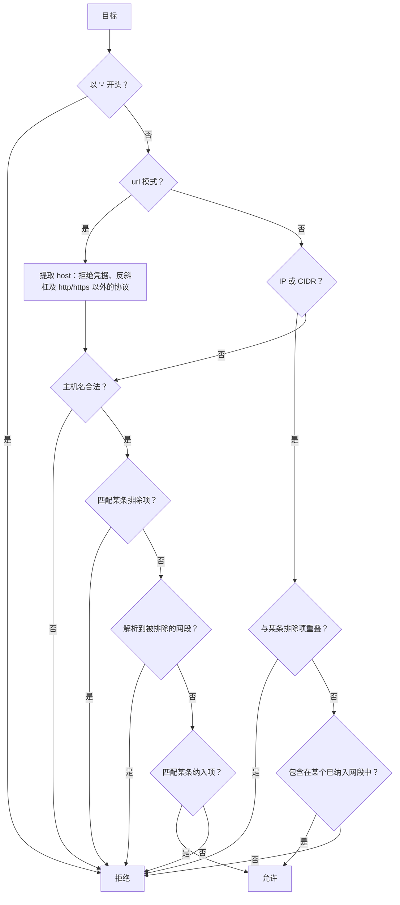

# 作用域文件

🌐 [Italiano](../03-scope.md) · [English](../en/03-scope.md) · **中文**

> ⚠️ 本页为机器翻译草稿，正式发布前需母语者校对。

作用域是一个包含两个小节的 TOML 文件。`subfinder-cli init` 会生成一个待填写的模板。

```toml
[engagement]
nome = "ACME-2026"
autorizzato_da = "Maria Rossi, CISO, Acme S.p.A."
riferimento = "ACME-2026-014"
valido_dal = 2026-11-02
valido_fino = 2026-11-13

[scope]
include = [
    "example.org",
]
esclude = [
    "interno.example.org",
]
```

## `[engagement]` 的字段

所有字段均为必填。缺少任何一个，程序以退出码 4 退出。

| 字段 | 填写内容 |
|---|---|
| `nome` | 一个简短标签，用于在日志中识别该项目 |
| `autorizzato_da` | 签署人的姓名、职务和公司 |
| `riferimento` | 合同或授权函编号。确认执行时也需要输入这串文字 |
| `valido_dal`, `valido_fino` | TOML 日期，包含首尾两天 |

超出这些日期，作用域即失效，任何命令都不会运行，dry-run 也不例外。

## `include` 和 `esclude` 的条目

| 形式 | 示例 | 含义 |
|---|---|---|
| 单个 IP | `192.0.2.10` | 该地址 |
| CIDR 网段 | `192.0.2.0/25` | 整个网段 |
| 主机名 | `app.example.org` | 仅该名称 |
| 通配符 | `*.stage.example.org` | 任意子域名，不含该域名本身 |

IPv4 和 IPv6 的处理方式相同，且互不混淆。

## 本工具期望的输入

模式为 `dominio`。域名须完整写出。*.example.org 这样的通配符不包含 example.org 本身。

传给 `lancia` 的目标可以是：

- `dominio` 模式：仅限域名，不带协议和路径；
- `host` 模式：IP 地址、精确的 CIDR 网段或主机名；
- `url` 模式：完整 URL（`https://host:8443/percorso`）、`host:porta` 或 `host`。只比对 host，从不比对路径。

## 判定流程



排除项永远优先。如果纳入了 `192.0.2.0/25` 又排除了 `192.0.2.1`，目标 `192.0.2.0/25` 会被整体拒绝，因为它包含被排除的地址。请改用单个主机，或把网段拆成避开该地址的若干块。

## 程序有意拒绝的情况

**主机位不为零的 CIDR**，例如 `192.0.2.5/25`。这种写法有歧义：请写成 `192.0.2.5` 或 `192.0.2.0/25`。

**纳入项中的 `0.0.0.0/0`**，即整个互联网。授权一切的作用域就不是作用域。

**针对顶级域的通配符**，例如 `*.org`。

**以 `-` 开头的目标**。它们是伪装成目标的标志。

**带凭据或反斜杠的 URL**，例如 `http://192.0.2.5@evil.example/`。看上去指向内部地址，实际 host 却是另一个。这是绕过过滤器的经典手法。

**http 和 https 以外的协议**（`ftp://`、`file://`、`javascript:`）。

## 主机名与 DNS

主机名只有在作用域中明确写出时才会被允许。程序不会通过解析来判断它是否"恰好"落在某个已纳入的网段内，因为 DNS 随时可能在你不知情时发生变化。

不过，如果作用域中有网段排除项，每个主机名都会被解析，解析结果落在任一排除网段内即被拒绝。这里有个实实在在的局限：在此处完成解析与片刻之后 subfinder 自己解析之间，DNS 可能给出不同的结果。对此有要求的测试，请直接使用 IP 地址。

## 端口

作用域不检查端口。只要 `app.example.org` 在作用域内，它的任何端口都在作用域内。如果客户只授权了部分端口，请写进授权文件，并使用限制端口的配置。

## 文件存放位置

放在仓库之外。本项目的 `.gitignore` 已排除 `scope.toml`，但别依赖它：客户名称和他们的网络信息不应进入任何仓库，私有仓库也不行。审计日志中包含作用域文件的哈希，因此运行后若修改了该文件，可以被发现。
