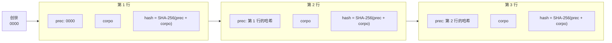

# 审计日志

🌐 [Italiano](../05-audit.md) · [English](../en/05-audit.md) · **中文**

> ⚠️ 本页为机器翻译草稿，正式发布前需母语者校对。

每次运行 `subfinder-cli lancia`，都会向 `subfinder-cli.audit.jsonl`（或通过 `--audit` 指定的文件）追加一行。它的用途是在几个月后回答三个问题：运行了什么、由谁运行、依据哪份授权。

## 记录的内容

| 事件 | 时机 |
|---|---|
| `dry_run` | 运行时未加 `--esegui` |
| `rifiutato` | 加了 `--esegui` 但未完成确认 |
| `avviata` | 启动 subfinder 之前 |
| `conclusa` | subfinder 退出时，附带其退出码 |

超出作用域的目标不会产生任何记录：程序会提前退出，没有任何东西被启动，也就无可记录。

每行包含 UTC 时间、项目名称、授权编号、系统用户、配置、目标、完整命令，以及当时所用作用域文件的 SHA-256。最后这一项用来证明作用域事后没有被改动。

## 敏感值

可能包含机密的标志（认证 header、token）在记录时会隐去取值：`-H [oscurato]`。终端上显示的命令仍是完整的，因为那是你自己输入的，但日志经常会被共享。这并非万无一失：如果把 token 放在其他位置（例如 URL 里），它仍会进入日志。

## 哈希链

每行都包含上一行的哈希。如果修改了中间某一行，它的哈希就对不上了，之后的所有行都会指向一个不存在的哈希。



校验方法：

```sh
subfinder-cli audit
subfinder-cli audit /percorso/altro.audit.jsonl
```

哈希链完整时，打印行数并以 0 退出；否则指出在哪一行断开，并以 7 退出。

## 能防什么，不能防什么

能发现中间某行被修改或删除，以及中间被插入伪造的行。

有两种情况发现不了。其一：对文件有写权限的人可以从头重建整条链，重新计算所有哈希，结果照样能通过校验。其二：删掉末尾几行后，剩下的仍是一条有效的链，只是变短了。

要覆盖这些情况，需要借助文件之外的东西。两个简单的办法：把最后一个哈希复制到一个不只由你控制的地方（发给客户的邮件、工单），或者把日志发送到只允许追加的远程日志服务器。`subfinder-cli` 不替你做这件事，因为这取决于你的基础设施。

## 保密

日志中包含客户的地址和名称。请把它当作客户数据对待：不要放进公开仓库，也不要发到聊天里。`.gitignore` 已将其排除，但每次提交前仍请检查。
