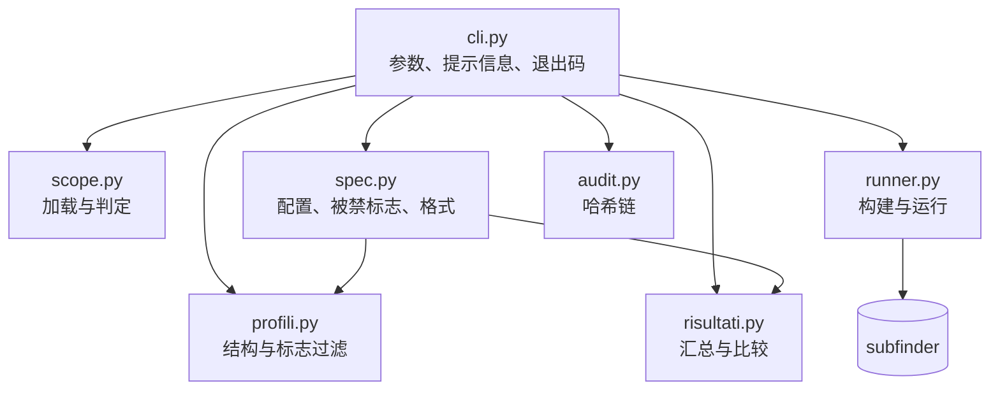
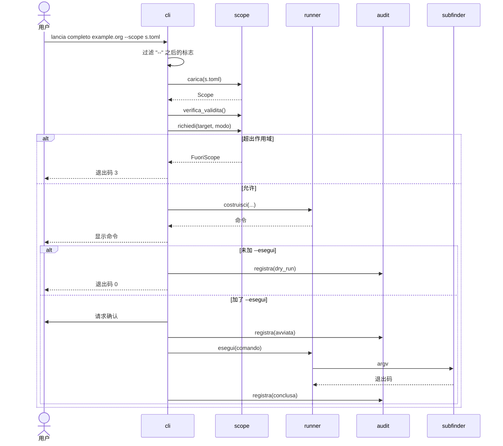

# 架构

🌐 [Italiano](../06-architettura.md) · [English](../en/06-architettura.md) · **中文**

> ⚠️ 本页为机器翻译草稿，正式发布前需母语者校对。

代码量很少，每个部分只负责一件事。一个下午就能通读。

## 模块



`scope.py`、`audit.py` 和 `profili.py` 对具体工具一无所知，也不启动进程。所有 subfinder 专属的内容（配置、被禁标志、结果的解析方式）都放在 `spec.py` 中。只有 `runner.py` 会调用 `subprocess`。这让测试既快又无需网络：没有任何测试需要安装 subfinder，集成测试使用的是一个假的可执行文件。

## 一条命令的执行路径



## 值得解释的设计选择

**从不使用 shell。** 命令是一个参数列表，直接传给 `subprocess.run`。像 `x; rm -rf ~` 这样的目标什么也做不了：它会先被作用域拒绝；即便到达工具，也只是个奇怪的名字而已。只要工具支持，目标会通过文件传入，而不是作为命令行参数。

**要么全部通过，要么全不运行。** 十个目标中有一个不被允许，就什么都不运行。部分运行比不运行更糟：它会让你以为自己覆盖了实际上并未覆盖的范围。

**标志过滤按名称进行。** Go 工具的标志（`-flag valore` 和 `-flag=valore`，一个或两个短横线）在比对前先做规范化，且不区分大小写。拿不准就禁止。

**审计记录在启动前写入。** 如果进程中途崩溃或被信号中断，日志里会有 `avviata` 而没有 `conclusa`：这本身就是有用的信息。如果只在运行结束后写入，被中断的运行就会凭空消失。

**未安装 subfinder 时 dry-run 也能用。** 它会显示预览并附一条说明。只有 `--esegui` 需要该二进制文件。

**最低要求 Python 3.11。** 需要标准库中的 `tomllib`，以免依赖外部 TOML 解析器。

## 局限

在信任它之前你需要知道的事。

1. 作用域文件是用户自己的声明。如果写错了，检查就毫无意义。
2. 直接运行 `subfinder` 的人不会经过这里。
3. 标志过滤器不是沙箱。
4. `scope.py` 做 DNS 解析与 subfinder 做 DNS 解析之间存在时间差。
5. 审计能发现局部篡改，发现不了整体重写。见 [05-audit.md](05-audit.md)。
6. 在没有 `os.geteuid` 的系统（Windows）上，权限检查不起作用。本项目只在 macOS 和 Linux 上测试过。
7. 我不可能了解 subfinder 每个版本的每个标志：如果新版本引入了能绕过作用域的标志，过滤器并不知道它。请报告给我们。

## 运行测试

```sh
make check
```
