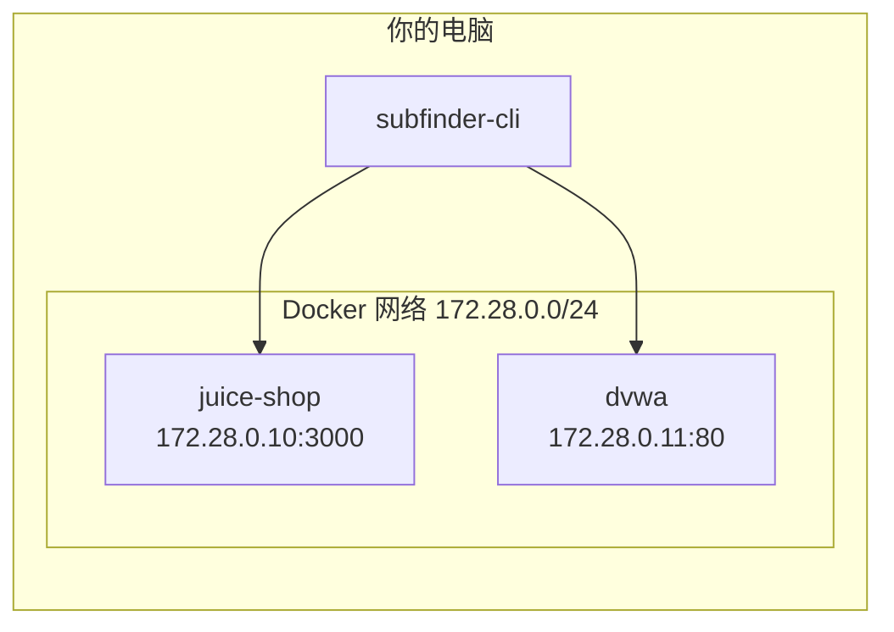

# 在哪里安全地试用

🌐 [Italiano](../07-lab.md) · [English](../en/07-lab.md) · **中文**

> ⚠️ 本页为机器翻译草稿，正式发布前需母语者校对。

学习时，需要一个属于你自己的分析对象。

Subfinder 针对真实域名和公开数据源工作，因此本地靶场没有意义。要稳妥地试用，请使用你自己的域名（几欧元的也行），配置几个子域名和一张证书（Let's Encrypt 就很好，证书会进入 certificate transparency）。把该域名加入 `include`，然后试试 `subfinder-cli lancia base tuo-dominio.tld`。

## Docker 靶场

`lab/` 中有一个 `docker-compose.yml`，会在一个隔离网络上启动两个故意留有漏洞的靶机。



这两个应用是 OWASP Juice Shop 和 DVWA，都是专门用来被攻击的公开项目。切勿将它们暴露在真实网络上。

```sh
cd lab && docker compose up -d
```

靶场的作用域文件位于 `examples/scope.lab.toml`。记得更新其中的日期：示例日期会过期。

## 练习

1. 用同一个配置运行一个作用域内的目标和一个作用域外的目标。会得到什么退出码？为什么连第一个也不运行？
2. 在 `esclude` 中加入一个主机后重新运行。有什么变化？
3. 把 `valido_fino` 改成一个已经过去的日期。
4. 打开 `subfinder-cli.audit.jsonl`，手动改掉中间某一行的一个字母，然后运行 `subfinder-cli audit`。
5. 尝试在 `--` 之后传入一个被禁标志，看看提示信息。
6. 运行两次，再用 `subfinder-cli confronta` 比较结果。

## 清理

```sh
docker compose down
```

## 说明

该 compose 文件并未在所有 Docker 版本上测试过。如果命令失败，请检查镜像是否仍在镜像仓库中，以及 `172.28.0.0/24` 网段是否与已在使用的网络冲突。
