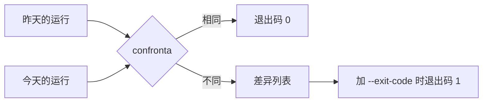

# 报告与比较

🌐 [Italiano](../08-rapporti.md) · [English](../en/08-rapporti.md) · **中文**

> ⚠️ 本页为机器翻译草稿，正式发布前需母语者校对。

每次带 `--esegui` 的运行都会在 `out/<data>-<profilo>/` 中留下结果（`risultati.*`）和所用的目标列表（`target.txt`）。

## 汇总

```sh
subfinder-cli rapporto out/20260101-120000-completo/
subfinder-cli rapporto out/20260101-120000-completo/ --formato markdown > rapporto.md
subfinder-cli rapporto out/20260101-120000-completo/ --formato json | jq .
```

可以传入一个目录（读取其中所有 `risultati*` 文件）或单个文件。`testo` 格式用于终端显示，`markdown` 可直接粘贴进报告，`json` 供需要用其他工具处理数据的人使用。

汇总按 **来源** 分组，并自动去重。

## 与上次相比有何变化

```sh
subfinder-cli confronta vecchio/ nuovo/
```

```
+ 新出现的结果
- 消失的结果
```

加上 `--exit-code` 后，若存在差异，命令以 1 退出，这样流水线就能察觉到新变化。



## 局限

用不同配置跑出的两次结果无法有意义地比较：第二次总会发现一些"新"东西。比较看的是结果的标识（例如 URL，或 host 与端口的组合），而不是细节：标题变了不算差异。
