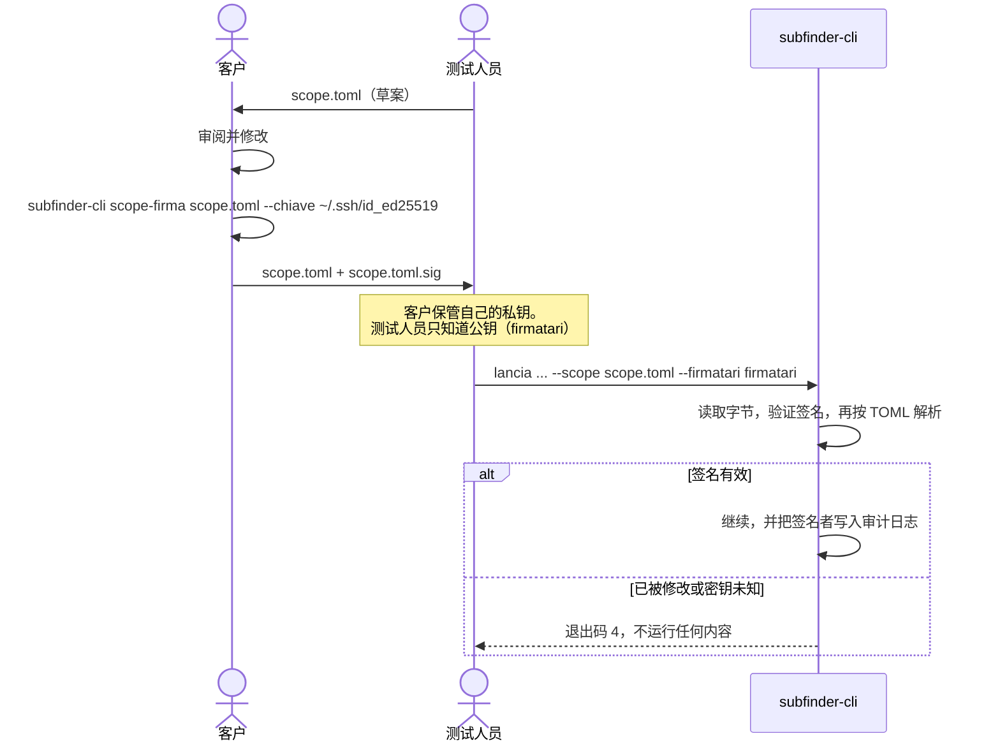

# 签名作用域

🌐 [Italiano](../09-firma.md) · [English](../en/09-firma.md) · **中文**

> ⚠️ 本页为机器翻译草稿，正式发布前需母语者校对。

作用域只是一份声明。有了签名，它就成了证据：有权授权的人用自己的 SSH 密钥对其签名；如果文件在签名后被修改，或签名所用的密钥不在已知列表中，`subfinder-cli` 将拒绝运行。

只需要 `ssh-keygen`，macOS 和任何装有 OpenSSH 的 Linux 都自带。不增加任何依赖。

## 分工



验证针对的正是随后被当作作用域读取的同一组字节：在检查与使用之间不存在文件可能被替换的时间窗口。

## 签名者文件

采用 OpenSSH 的 `allowed_signers` 格式，每个密钥一行：

```
maria.rossi@acme.example namespaces="subfinder-cli" ssh-ed25519 AAAAC3NzaC1lZDI1NTE5AAAA...
```

`namespaces` 字段把密钥绑定到本程序：为 `git` 或其他用途做的签名不会被接受，即使用的是同一把密钥。

## 步骤

客户（或有授权权限的人）签名：

```sh
subfinder-cli scope-firma scope.toml --chiave ~/.ssh/id_ed25519
```

这会生成 `scope.toml.sig`。如果密钥设有口令，`ssh-keygen` 会提示输入。如果已存在签名，命令不会覆盖它：要重新签名，请先手动删除。

测试人员检查：

```sh
subfinder-cli scope-verifica scope.toml --firmatari firmatari
# ok：maria.rossi@acme.example 的有效签名（SHA256:...）
```

然后在强制签名的前提下运行：

```sh
subfinder-cli lancia completo example.org --scope scope.toml --firmatari firmatari
```

不加 `--firmatari` 时不要求签名。如果希望始终强制签名，可以把它写进 alias。

## 审计日志中记录什么

日志的每一行除了作用域文件的哈希外，还带有 `scope_firmato_da` 和 `scope_firma_fp`（密钥指纹）。这样即使过了几个月，不仅能说清当时用的是哪个作用域，还能说清是谁签的。

## 它做不到的事

它无法判断签名人是否真的有权授权这些系统：这由合同决定，而不是密码学。它无法防范私钥被盗。它不能阻止有人不加 `--firmatari` 运行本工具，也不能阻止有人直接运行底层工具。

签名本身没有有效期：时间上的有效性以文件中声明的为准（`valido_dal`、`valido_fino`），而由于这些字段已被签名，无法被悄悄延长。
